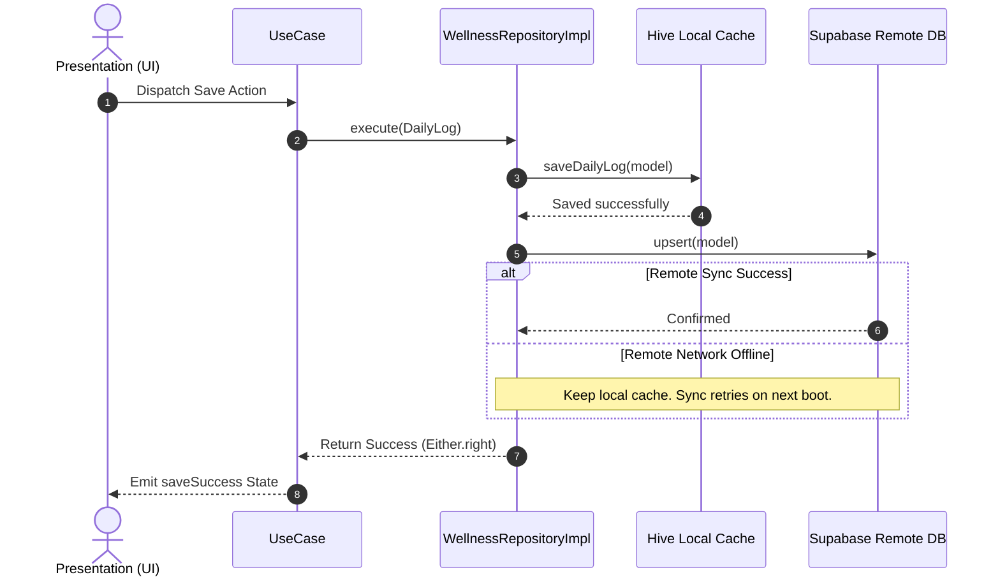

# System Architecture - LungSense Wellness

## Core Architecture Pattern
We follow **Feature-First Clean Architecture**, which splits code by feature vertical rather than layer horizontal. This structure enables modularity, team scaling, and makes features highly self-contained.

```
lib/
 └── features/
      └── feature_name/
           ├── data/          # DataSources, Repositories implementations, Models (JSON-serializable)
           ├── domain/        # Entities, Repositories interfaces, Use Cases (Pure Dart)
           └── presentation/  # Widgets, Blocs, State, Events
```

---

## Clean Architecture Layers

### 1. Domain Layer (Pure Dart)
The core of the feature, fully isolated from frameworks, databases, and UI widgets.
- **Entities**: Simple, immutable Dart classes containing user data models (e.g. `UserEntity`, `DailyLogEntity`). Inherits from `Equatable` for value comparisons.
- **Use Cases**: Singular business logic actions (e.g. `LoginUseCase`, `SaveDailyLogUseCase`) executing contracts.
- **Repositories Interfaces**: Contract definitions outlining how data should be retrieved or saved, decoupled from database mechanics.

### 2. Data Layer
The gateway to databases, caches, and remote APIs.
- **Models**: Database-specific representations of entities. Implements serialization logic (`fromJson`, `toJson`) and Hive adapters.
- **DataSources**: Interfaces and concrete implementations querying local cache (Hive) or remote backend (Supabase client).
- **Repositories Implementations**: Concrete classes implementing the domain repository interfaces. Directs coordination between local cache fallback and remote syncing.

### 3. Presentation Layer (Flutter UI)
Responsible for user interactions and displaying state.
- **Widgets / Pages**: Standard Flutter widgets (e.g. `LoginPage`, `RecordPage`).
- **BLoCs / Cubits**: Coordinating components using `flutter_bloc`. Receives UI events, triggers Use Cases, and emits states to drive screen updates.

---

## 🔒 Layer Isolation Rules

We enforce strict imports isolation to maintain a decoupled system:

| Layer | Imports Permitted | Imports Forbidden |
| :--- | :--- | :--- |
| **Presentation** | Flutter UI, Blocs, UseCases, Entities, Theme, DI | Direct Database queries, HTTP Clients, SQL |
| **Domain** | Pure Dart, `fpdart` (`Either`), `equatable` | Flutter UI, Widgets, Hive, Supabase, JSON, HTTP |
| **Data** | Hive, Supabase, HTTP, Models, Domain Interfaces | Flutter UI widgets, Blocs, Pages |

---

## 🔄 Data Sync & Offline Caching Flow

For wellness records, check-ins, and audio recording lists, we employ a local cache workflow:



---

## 🛠️ Service Locator & Dependency Injection
We use `get_it` service locator (`sl`) declared inside [injection_container.dart](file:///c:/Users/naffi/OneDrive/Documents/DigiBiomics/Lungsense_wellness/lib/core/di/injection_container.dart). 

Dependencies are initialized in order during app startup:
1. **External Services**: Hive initialization, Supabase clients.
2. **DataSources**: Remote and local datasource builders.
3. **Repositories**: Concrete bindings matching domain interfaces.
4. **Use Cases**: Instantiation of UseCases.
5. **Blocs / Controllers**: Factory bindings generated per request.
